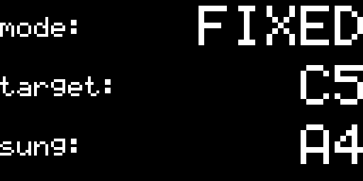

# Auto-Tuner in a Noisy Environment

A real-time vocal pitch corrector that runs on an **STM32F446RE** (NUCLEO-F446RE). It is built to keep working when the room is noisy. A digital MEMS microphone feeds a streaming DSP pipeline that suppresses noise, detects pitch, snaps it to a note and shifts the voice with LPC-based TD-PSOLA. The tuned audio is streamed to a laptop over UART, and an OLED shows the current mode, target and the note being sung.

The project has two parts that implement the same algorithm:

| Folder | What it is |
|---|---|
| [`python_prototype/`](python_prototype) | Reference implementation and evaluation (NumPy/SciPy). The algorithm was designed and tested here first. |
| [`autotuner_f446re/`](autotuner_f446re) | STM32CubeIDE firmware: the C port of `autotuner.py`, plus a laptop receiver and a PC test kit that checks the C code against Python. |



---

## Pipeline

One call per 128-sample hop (8 ms at 16 kHz), frame N = 512:

```
INMP441 mic (I2S, 16 kHz)
  └─ noise suppressor (STFT Wiener gain, minimum-statistics noise tracking)
       ├─ detection path: 75 Hz–1 kHz band-pass (2 biquads)
       │     → FFT autocorrelation (1024-pt) → f0 + confidence
       │     → MIDI note, median filter, hysteresis
       │     → tuning mode → shift in semitones (clamp ±12, out-of-range flag)
       └─ audio path: 75 Hz high-pass
             → LPC split: residual e = A(z)·x
             → TD-PSOLA on the residual (pitch marks by cross-correlation)
             → 1/A(z) synthesis (formants kept)
             → dry/unvoiced crossfade → level match → pause gate (SNR-gated)
  → UART packet to the laptop + OLED status
```

**Tuning modes**

- **NEAREST**: snaps to the closest note, within about ±0.5 semitones. An optional scale and key can restrict the allowed notes.
- **FIXED**: shifts to a chosen target note, clamped to ±12 semitones. The laptop receiver flags when the singer is out of range and reports the out-of-range share at the end of a take.

**Latency:** about 62 ms of algorithmic delay (24 ms denoiser + 38 ms shifter lookahead).

---

## Hardware

| Part | Connection |
|---|---|
| NUCLEO-F446RE | 180 MHz SYSCLK (HSE bypass from ST-LINK), I2S clock tuned for exactly 16 000 Hz |
| INMP441 I2S microphone | WS → PB12, SCK → PB10, SD → PC1, L/R → GND, VDD → 3V3 |
| SH1106 / SSD1306 I2C OLED | SCL → PB8 (D15), SDA → PB9 (D14), 3V3, GND |
| Laptop | USB (ST-LINK virtual COM port, 921600 8N1): audio out and text commands in |

The full peripheral setup (clock tree, DMA streams, NVIC, stack/heap) is in [`CUBEMX_PARAMETERS.md`](autotuner_f446re/CUBEMX_PARAMETERS.md).

---

## Getting started

### Python prototype

```bash
pip install -r requirements.txt
cd python_prototype

python autotuner.py wav_files/humming.wav -o out.wav                          # NEAREST mode
python autotuner.py wav_files/humming.wav -o out.wav --mode fixed --target C4 # FIXED mode
python autotuner.py wav_files/humming.wav -o out.wav --plot pitch.png         # with pitch plot
python autotuner.py --demo                                                    # synthetic voice
```

Useful options: `--scale major --key G`, `--retune 0.05` (retune time in seconds, 0 = hard snap), `--no-denoise`, `--gate-snr 6`, `--classic` (plain v1 TD-PSOLA, for A/B comparison).

### Tests and evaluation

There are three scripts, and they answer different questions:

| Script | Question | Output |
|---|---|---|
| `selftest.py` | **Is it correct?** Does each block do what the design says? | PASS/FAIL per check |
| `evaluate.py` | **How well does it work in noise?** And does the band-pass help? | metrics, tables, figures |
| `gate_eval.py` | How well does the pause gate keep voice and reject noise? | table |

- **`selftest.py`** is a list of pass/fail checks with fixed thresholds. Most checks test one block at a time, using inputs whose correct answer is known exactly: pure tones, a fixed MIDI sequence, digital silence. Examples: the band-pass is −3 dB at 75 Hz and 1 kHz, the detector is within 5 cents from 82 to 990 Hz, hysteresis holds the note, streaming output equals offline output, the out-of-range flag turns on after 6 hops, and the OLED text fits. No noise is added. These are also the checks to repeat on the C port, so run them after every code change.
- **`evaluate.py`** is an experiment, not a pass/fail test. It mixes the test signal with 4 noise types (white, pink, fan + hum, babble) at 5 levels (clean, 20, 10, 0, −5 dB SNR) over several random seeds. Then it runs the detection path with and without the band-pass and measures RPA, MAE, note accuracy, false alarms, octave errors and the SNR gain of the filter. It covers the detection path only (pitch, note, voicing), not the shifted audio.
- **`gate_eval.py`** runs the full pipeline with the old gate and with the SNR gate. It reports how much of the voice is kept and how often the gate opens on noise alone.

```bash
cd python_prototype
python selftest.py                                          # synthetic phrase / sustained A3
python selftest.py --wav wav_files/introduce.wav            # pipeline checks (6-8) on a real recording
python evaluate.py                                          # synthetic phrase, exact F0 -> results/
python evaluate.py --wav wav_files/introduce.wav --seeds 5  # real recording -> results/introduce/
python gate_eval.py wav_files/introduce.wav                 # pause gate -> table on stdout
```

**Real recordings (`--wav`).** A recording has no exact pitch truth, so `wav_reference.py` computes a reference with pYIN (librosa). pYIN is a different algorithm from the prototype's correlogram. The intended note is the nearest note to that reference. In this mode, "clean" means the file as recorded, including its own room noise, and false alarms are counted on its noise-only frames. In `selftest.py --wav`, the block checks (sections 1–5) stay the same. The pipeline checks measure the input and output pitch with pYIN, because a lowered voice drops below the detector's 80 Hz floor.

### Firmware

1. Open `autotuner_f446re/` in **STM32CubeIDE** (*File → Import → Existing Projects into Workspace*).
2. Build and flash to the NUCLEO-F446RE.
3. On the laptop, run the receiver. It plays the tuned audio, saves a WAV and accepts commands:

```bash
cd autotuner_f446re/laptop
python rx_audio.py                          # auto-detects the ST-LINK port, plays on the default output
```

**Choosing the output device.** First list the audio devices (and serial ports) on your laptop:

```bash
python rx_audio.py --list
```

Each device is printed with a number in front of it. Pass that number to `--output` to play the tuned audio on that device:

```bash
python rx_audio.py --output 5                            # play on device number 5
python rx_audio.py --mode fixed --target C4 --output 5   # same, starting in FIXED mode with target C4
```

If `--output` is not given, the receiver uses the system's default output device. If the number you pass doesn't exist or isn't an output device, it prints a warning and falls back to the default output. (`--output` also accepts part of a device name, e.g. `--output airpods`, but device numbers can change when Bluetooth devices connect or disconnect, so run `--list` again if the sound goes to the wrong place.)

While it runs, type a command and press Enter:

| Command | Effect |
|---|---|
| `set mode nearest` | snap to the closest note |
| `set mode fixed` | shift to the fixed target |
| `target <note>` | set the target, e.g. `target C5`, `target F#3`, `target Bb2` |

### Checking the C port against Python

`pc_test/` compiles the same `at_*.c` files for the PC and compares the output with `autotuner.py`. You need gcc (MSYS2 or WSL on Windows):

```bash
cd autotuner_f446re/pc_test
sh run_test.sh ../../python_prototype/wav_files/introduce.wav       # NEAREST
sh run_test.sh ../../python_prototype/wav_files/introduce.wav C4    # FIXED, target C4
```

---

## Results

**Pitch detection in noise** (synthetic vowel, from `evaluate.py`). RPA is the raw pitch accuracy, i.e. the share of voiced frames within ±50 cents:

| Noise | SNR | RPA, no filter | RPA, band-pass |
|---|---|---|---|
| clean | – | 0.99 | 0.99 |
| white | 0 dB | 0.93 | **0.94** |
| white | −5 dB | 0.69 | **0.81** |
| pink | 0 dB | 0.84 | **0.88** |
| babble | 10 dB | 0.92 | 0.90 |

On average, the detection band-pass improves SNR by **+8.2 dB for white noise** and +6.0 dB for pink noise. It does little against fan hum or babble, which overlap the voice band. The full table is in [`python_prototype/results/summary.md`](python_prototype/results/summary.md), with figures in the same folder.

**Real recording** (`introduce.wav`: a low male voice around 80–100 Hz, with about 10 dB SNR of room noise already in the file, reference pitch from pYIN, 5 seeds). These are the numbers used in the report:

| Noise | SNR | RPA, no filter | RPA, band-pass |
|---|---|---|---|
| file as recorded | – | 0.81 | 0.83 |
| white | 0 dB | 0.70 | **0.74** |
| white | −5 dB | 0.40 | **0.53** |
| pink | 0 dB | 0.47 | **0.54** |
| fan + hum | 0 dB | 0.24 | 0.26 |
| babble | 0 dB | 0.38 | 0.36 |

On the recording as it is, the MAE is 13.8 cents and note accuracy is 0.93. The band-pass gain is +8.4 dB for white noise. `selftest.py --wav` passes 35 of 49 checks. Most failures share one cause: octave-up detections at syllable starts, which the note tracker holds across unvoiced gaps. The full output is in [`python_prototype/results/introduce/`](python_prototype/results/introduce).

**C port vs. Python** (see [`C_PORT.md`](autotuner_f446re/C_PORT.md) §5):

- Voicing, target note and status agree on **100 % of hops** (6 705 hops, 53.6 s recording). The pitch differs by at most 0.01 cent.
- A double-precision build reproduces the Python output bit for bit.
- The firmware uses **107 KB of 128 KB RAM**. The estimated CPU load is **45–60 %** of the 8 ms hop budget.

---

## Repository layout

```
.
├── autotuner_f446re/
│   ├── App/                 DSP modules (at_*.c) + app glue, OLED, UART
│   ├── Core/                CubeMX-generated startup, main.c, HAL config
│   ├── Drivers/             STM32 HAL + CMSIS (from ST)
│   ├── laptop/rx_audio.py   receiver / command line
│   ├── pc_test/             C-vs-Python test kit
│   ├── C_PORT.md            module-by-module guide to the C code
│   └── CUBEMX_PARAMETERS.md peripheral configuration
├── python_prototype/
│   ├── autotuner.py         reference implementation (denoiser + LPC TD-PSOLA)
│   ├── evaluate.py          noise-robustness evaluation (experiment: metrics + figures)
│   ├── synth.py             synthetic voice + noise generators
│   ├── selftest.py          pass/fail checks against the design (also for the C port)
│   ├── wav_reference.py     pYIN reference pitch for real recordings (--wav)
│   ├── gate_eval.py         pause-gate evaluation
│   ├── playback.py          audio output helper
│   ├── results/             evaluation figures and tables (results/introduce/ = introduce.wav)
│   └── wav_files/           sample recordings
└── requirements.txt
```

---

## Limitations

- With a single microphone, slowly fluctuating noise (pink/brown, babble) can look like voice to the pause gate. `gate_snr_db` sets the trade-off between keeping voice and rejecting noise.
- Fan hum and babble overlap the voice band, so the detection band-pass doesn't help against them.
- The B1 button isn't wired up yet. Modes are changed from the laptop.

---

*Final project for a Digital Signal Processing course, Computer Engineering, Kasetsart University.*
